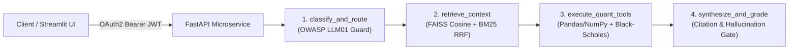

# FinPulse AI Agent (`finpulse-ai-agent`)

Containerized **Python + FastAPI + LangChain + LangGraph + FAISS** microservice and **Streamlit** evaluation dashboard for financial document **Retrieval-Augmented Generation (RAG)** and **Pandas / NumPy** quantitative market-data & options Greek analysis.

---

## Documentation Index

- **[System Architecture & LangGraph Workflow](docs/ARCHITECTURE.md)** — 4-node `StateGraph` design, FAISS `IndexFlatIP` + BM25 Reciprocal Rank Fusion pipeline, and OWASP LLM01 / JWT security model.
- **[REST API Reference](docs/API_REFERENCE.md)** — Request/response JSON schemas, authentication headers, and curl examples for all 7 FastAPI endpoints.
- **[Quantitative & Retrieval Math](docs/QUANT_AND_RAG_MATH.md)** — Exact equations for session VWAP ($\pm 1\sigma$), ATR(14), Wilder RSI(14), Empirical Bayes touch probability, Black-Scholes Greeks, Newton-Raphson IV solver, and BM25 + RRF.

---

## System Flow



---

## Architecture & Key Capabilities

1. **Hybrid Vector + Lexical RAG (`src/finpulse/rag.py`):**
   - Recursive markdown section chunking with document/category/ticker provenance metadata.
   - 384-dimensional $L_2$-normalized dense vector embeddings indexed in **FAISS (`faiss.IndexFlatIP`)** for exact cosine similarity search.
   - **Reciprocal Rank Fusion (RRF, $k=60$)** combining dense **FAISS** cosine retrieval with **BM25** lexical scoring and metadata filtering.
   - **OWASP LLM01 Prompt-Injection Defense:** Iterative stripping of `<system>`, `<instructions>`, and override directives prior to embedding and prompt synthesis.
2. **Stateful 4-Node `LangGraph` Agent (`src/finpulse/agent.py`):**
   - Built on `langgraph.graph.StateGraph` and `langchain_core.tools.tool`:
     `classify_and_route -> retrieve_context -> execute_quant_tools -> synthesize_and_grade`
   - Routes queries across RAG knowledge retrieval, **Pandas / NumPy** indicator computation, and **Black-Scholes** Greeks, returning structured Pydantic JSON with citations, hallucination verification, and per-node latency traces (`ms`).
3. **Vectorized `Pandas` & `NumPy` Quantitative Engine (`src/finpulse/analytics.py`):**
   - Intraday session **VWAP** (with $\pm 1\sigma$ volume-weighted bands), **ATR(14)**, **Wilder/EWMA RSI(14)**, **EMA(9/20)**, and **RVOL**.
   - Empirical Bayes barrier-crossing **touch-probability** estimator ($+k \cdot \text{ATR}$ target before $-m \cdot \text{ATR}$ stop).
   - **Black-Scholes-Merton** option pricing, analytical Greeks (**Delta, Gamma, daily Theta, Vega**), and a **Newton-Raphson Implied Volatility (IV) solver** with bisection bounds fallback.
4. **OAuth2 / JWT Security & FastAPI Microservice (`src/finpulse/api.py`, `src/finpulse/auth.py`):**
   - HS256 **JWT Bearer** authentication (`/v1/auth/token`, `PyJWT`) with constant-time `hmac.compare_digest` client verification and SHA-256 `appIdHash` OAuth2 auth-code signature generation.
   - OpenAPI-documented REST endpoints (`/health`, `/v1/auth/token`, `/v1/rag/ingest`, `/v1/rag/query`, `/v1/quant/indicators`, `/v1/quant/greeks`, `/v1/agent/analyze`).

---

## Quickstart

```bash
# 1. Install dependencies
pip install -r requirements.txt

# 2. Run the pytest suite
pytest -v

# 3. Start the FastAPI server
uvicorn finpulse.api:app --reload --app-dir src --port 8000

# 4. Launch the Streamlit evaluation UI
PYTHONPATH=src streamlit run ui.py
```

---

## Project Layout

```text
finpulse-ai-agent/
├── .github/workflows/ci.yml        # GitHub Actions CI running pytest
├── data/corpus/                    # Built-in financial & derivatives markdown corpus
│   ├── intraday_microstructure.md
│   ├── options_greeks_and_iv.md
│   └── risk_and_execution_governance.md
├── docs/                           # Detailed architecture, API, and mathematical docs
│   ├── API_REFERENCE.md
│   ├── ARCHITECTURE.md
│   └── QUANT_AND_RAG_MATH.md
├── src/finpulse/
│   ├── __init__.py
│   ├── agent.py                    # LangChain @tool functions + 4-node LangGraph StateGraph
│   ├── analytics.py                # Pandas/NumPy indicators, touch probability & Black-Scholes Greeks/IV
│   ├── api.py                      # FastAPI application & OpenAPI routes
│   ├── auth.py                     # OAuth2 / HS256 JWT token issuance & SHA-256 appIdHash helper
│   ├── rag.py                      # OWASP LLM01 sanitizer, chunker, FAISS IndexFlatIP + BM25 RRF
│   └── schemas.py                  # Pydantic v2 request/response contracts
├── tests/
│   └── test_finpulse.py            # End-to-end pytest suite (RAG, FAISS, Quant, LangGraph, FastAPI, JWT)
├── Dockerfile
├── pyproject.toml
├── requirements.txt
└── ui.py                           # Streamlit evaluation dashboard
```
