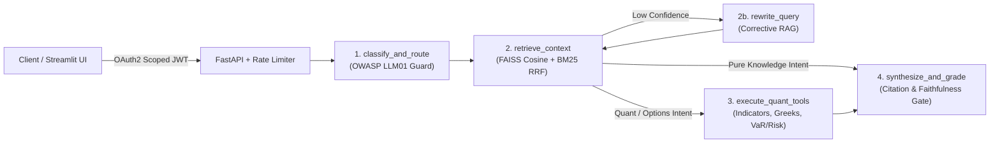

# FinPulse AI Agent (`finpulse-ai-agent`)

Containerized **Python + FastAPI + LangChain + LangGraph + Hugging Face (`sentence-transformers`) + FAISS** microservice and **Streamlit** evaluation dashboard for financial document **Retrieval-Augmented Generation (RAG)** and **Pandas / NumPy** quantitative market-data & options Greek analysis.

---

## Documentation Index

- **[System Architecture & LangGraph Workflow](docs/ARCHITECTURE.md)** — Conditional `StateGraph` design, Hugging Face `BAAI/bge-small-en-v1.5` + FAISS `IndexFlatIP` + BM25 Reciprocal Rank Fusion pipeline, sequence diagrams, and OWASP LLM01 / JWT RBAC security model.
- **[REST API Reference](docs/API_REFERENCE.md)** — Request/response JSON schemas, OAuth2 RBAC scope rules, correlation headers, and curl examples for all 11 FastAPI endpoints.
- **[Quantitative & Retrieval Math](docs/QUANT_AND_RAG_MATH.md)** — Exact equations for session VWAP ($\pm 1\sigma$), ATR(14), Wilder RSI(14), Empirical Bayes touch probability, Black-Scholes 1st/2nd-order Greeks, Newton-Raphson IV solver, VaR/CVaR, and BM25 + RRF + graded NDCG@K.
- **[Architectural Decision Records (ADRs) & Engineering Tradeoffs](docs/DESIGN_DECISIONS.md)** — Design rationale for Hybrid RRF vs. linear score blending, Corrective RAG conditional edges, deterministic `@tool` faithfulness verification, offline-first Hugging Face loading, and horizontal scaling (`IndexHNSWFlat`, Redis token buckets).

---

## System Flow



---

## Architecture & Key Capabilities

1. **Thread-Safe Hybrid Vector + Lexical RAG & IR Evaluation (`src/finpulse/rag.py`):**
   - Recursive markdown section chunking with document/category/ticker provenance metadata and SHA-256 content-hash deduplication.
   - **Hugging Face `SentenceTransformer("BAAI/bge-small-en-v1.5")`** 384-dimensional $L_2$-normalized dense vector embeddings (with thread-safe vector caching and automatic offline/CI fallback) indexed in **FAISS (`faiss.IndexFlatIP`)** for exact cosine similarity search, protected by `threading.RLock`.
   - **Reciprocal Rank Fusion (RRF, $k=60$)** combining dense **FAISS** cosine retrieval with **Okapi BM25** lexical scoring and metadata filtering.
   - **Golden IR Evaluation Benchmark (`/v1/rag/evaluate`):** Automated ablation across `hybrid_rrf`, `dense_only`, and `lexical_only` computing **$\text{Recall}@K$**, **$\text{MRR}@K$**, **$\text{NDCG}@K$**, and **p95 latency**.
   - **OWASP LLM01 Prompt-Injection Defense:** Iterative stripping of `<system>`, `<instructions>`, and override directives prior to embedding and prompt synthesis.
2. **Conditional & Self-Correcting `LangGraph` Agent (`src/finpulse/agent.py`):**
   - Built on `langgraph.graph.StateGraph` with `add_conditional_edges` and `langchain_core.tools.tool`:
     - **Corrective RAG Loop:** Routes low-confidence retrievals through `rewrite_query` for domain synonym/acronym expansion before re-querying FAISS + BM25.
     - **Conditional Tool Bypass:** Pure `rag_knowledge` queries bypass `execute_quant_tools` at the graph-edge level.
     - **Grounded LLM Synthesis + Numerical Faithfulness Verifier:** Supports **Gemini (`GEMINI_API_KEY`)** and **OpenAI (`OPENAI_API_KEY`)** REST synthesis with automatic deterministic fallback and `verify_numerical_faithfulness` cross-checking every synthesized number against tool outputs (`QuantIndicatorSummary`, `OptionGreeksResponse`, `PositionSizingResponse`).
     - **Server-Sent Events (SSE) Streaming (`/v1/agent/stream`):** Streams real-time per-node execution events.
3. **Vectorized `Pandas` & `NumPy` Quant + Pre-Trade Risk Engine (`src/finpulse/analytics.py`):**
   - Intraday session **VWAP** ($\pm 1\sigma$ volume-weighted bands), **ATR(14)**, **Wilder/EWMA RSI(14)**, **EMA(9/20)**, **RVOL**, and Empirical Bayes barrier-crossing **touch-probability** estimator.
   - **Black-Scholes-Merton** option pricing, 1st & 2nd order analytical Greeks (**Delta, Gamma, daily Theta, Vega, Vanna, daily Charm**), **Put-Call Parity residual check**, and a **Newton-Raphson + Bisection Implied Volatility (IV) solver**.
   - **Pre-Trade Risk Governance (`/v1/quant/risk`):** ATR volatility-normalized position sizing, **Gross-R vs. Net-R** after transaction charges, **Half-Kelly fraction**, **95% VaR & CVaR (Expected Shortfall)**, and hard $-2.0R$ daily drawdown wall enforcement.
4. **OAuth2 RBAC Scopes, Rate Limiting & Observability (`src/finpulse/api.py`, `src/finpulse/auth.py`):**
   - HS256 **JWT Bearer** authentication (`/v1/auth/token`, `PyJWT`) with fine-grained OAuth2 scope enforcement (`rag:write`, `agent:run`), constant-time `hmac.compare_digest` verification, and SHA-256 `appIdHash` signature generation.
   - Thread-safe **Token-Bucket Rate Limiter** (`429 Too Many Requests`), `X-Request-ID` & `X-Process-Time-Ms` correlation middleware, and `/metrics` latency percentile telemetry (`p50`/`p95`).

---

## Golden IR Benchmark Ablation (`POST /v1/rag/evaluate`)

Evaluated across the 9-query domain benchmark (`DEFAULT_EVAL_BENCHMARK` in `src/finpulse/rag.py`, `top_k = 3`, 20 indexed corpus chunks with cached `BAAI/bge-small-en-v1.5` 384-dim vectors):

| Retrieval Mode | `Recall@3` | `MRR@3` | Graded `NDCG@3` | Warm Latency (`ms`) |
| --- | --- | --- | --- | --- |
| **`hybrid_rrf` (`FAISS IndexFlatIP + BM25 RRF`)** | **`1.0000`** | **`1.0000`** | **`0.9938`** | **`0.61 ms`** |
| `dense_only` (`FAISS IndexFlatIP` Cosine) | `1.0000` | `1.0000` | `0.9876` | `0.58 ms` |
| `lexical_only` (`Okapi BM25`) | `1.0000` | `1.0000` | `0.9938` | `0.53 ms` |

---

## Quickstart & Docker Deployment

```bash
# 1. Install dependencies
pip install -r requirements.txt

# 2. Run the 17-test pytest suite
pytest -v

# 3. Start the FastAPI server
uvicorn finpulse.api:app --reload --app-dir src --port 8000

# 4. Launch the 2-tab Streamlit evaluation & risk governance UI
PYTHONPATH=src streamlit run ui.py

# 5. Or build and run the container image
docker build -t finpulse-ai-agent:0.2.0 .
docker run --rm -p 8000:8000 finpulse-ai-agent:0.2.0
```

---

## Project Layout

```text
finpulse-ai-agent/
├── .github/workflows/ci.yml        # GitHub Actions CI running CPU PyTorch + pytest
├── data/corpus/                    # Built-in financial & derivatives markdown corpus
│   ├── intraday_microstructure.md
│   ├── options_greeks_and_iv.md
│   └── risk_and_execution_governance.md
├── docs/                           # Detailed architecture, API, math, and ADR docs
│   ├── API_REFERENCE.md
│   ├── ARCHITECTURE.md
│   ├── DESIGN_DECISIONS.md
│   └── QUANT_AND_RAG_MATH.md
├── src/finpulse/
│   ├── __init__.py
│   ├── agent.py                    # Conditional LangGraph StateGraph + LLM/Faithfulness gate
│   ├── analytics.py                # Pandas/NumPy indicators, 1st/2nd-order Greeks & VaR/Risk
│   ├── api.py                      # FastAPI routes, TokenBucketRateLimiter & /metrics telemetry
│   ├── auth.py                     # OAuth2 RBAC scopes, HS256 JWT & SHA-256 appIdHash helper
│   ├── rag.py                      # OWASP LLM01 sanitizer, BGE/FAISS + BM25 RRF & IR benchmark
│   └── schemas.py                  # Pydantic v2 request/response contracts
├── tests/
│   └── test_finpulse.py            # 17 end-to-end pytest tests (RAG, Quant, Risk, LangGraph, API)
├── Dockerfile
├── pyproject.toml
├── requirements.txt
└── ui.py                           # 2-tab Streamlit Agent & IR Benchmark dashboard
```
