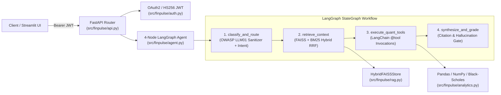

# System Architecture — FinPulse AI Agent

## 1. Overview & Design Goals

`FinPulse AI Agent` is a containerized Python microservice and interactive evaluation suite designed for **grounded financial research and quantitative derivatives/intraday analysis**. It solves two common failure modes of naive LLM financial wrappers:
1. **Unverified numerical hallucination:** Free-form LLMs routinely miscalculate VWAP bands, ATR stop distances, or Black-Scholes option Greeks. In `FinPulse AI`, all numerical metrics are computed deterministically by vectorized **Pandas / NumPy** and analytical **Black-Scholes-Merton** `@tool` functions (`src/finpulse/analytics.py`).
2. **Pure-vector retrieval misses exact financial symbols & formulas:** Dense embeddings alone often miss exact ticker filters (`NIFTY`, `BANKNIFTY`), strike numbers, or domain acronyms (`RVOL`, `VWAP`, `OWASP LLM01`). `FinPulse AI` fuses **FAISS (`IndexFlatIP`)** cosine similarity with **BM25** lexical scoring via **Reciprocal Rank Fusion (RRF)**.

---

## 2. High-Level Architecture Diagram

---

## 3. Stateful 4-Node `LangGraph` Workflow (`src/finpulse/agent.py`)

The agent state (`FinPulseGraphState`) is a strictly typed `TypedDict` carrying the request, sanitized query, routed intent, retrieved citations, quantitative outputs, synthesized report, hallucination gate status, confidence score, and per-node execution trace.

| Node | Responsibility | Inputs Read | State Keys Written |
|---|---|---|---|
| **`1. classify_and_route`** | Strips prompt-injection payloads (`sanitize_prompt_input`) and classifies the query into one of four execution intents: `quant_metrics`, `options_greeks`, `rag_knowledge`, or `hybrid_research`. | `request` | `sanitized_query`, `routed_intent`, `execution_trace` |
| **`2. retrieve_context`** | Queries `HybridFAISSStore.search()` using Reciprocal Rank Fusion ($k=60$) over FAISS cosine similarity and BM25 lexical scores. | `sanitized_query`, `request.top_k` | `citations`, `execution_trace` |
| **`3. execute_quant_tools`** | Invokes `LangChain Core` `@tool` functions (`compute_intraday_indicators_tool` and/or `compute_option_greeks_tool`) when the routed intent or request payload requires numerical computation; skips cleanly on pure knowledge queries. | `routed_intent`, `request.bars`, `request.option_params` | `quant_summary`, `option_greeks`, `execution_trace` |
| **`4. synthesize_and_grade`** | Combines deterministic tool outputs with top retrieved corpus citations, runs the citation/hallucination gate (`hallucination_check_passed`), and computes a bounded confidence score (`0.55..0.99`). | `citations`, `quant_summary`, `option_greeks` | `answer`, `hallucination_check_passed`, `confidence_score`, `execution_trace` |

---

## 4. Hybrid RAG Pipeline (`src/finpulse/rag.py`)

### 4.1 Recursive Markdown Chunking (`chunk_document`)
- Splits documents along Markdown level-1/level-2 headers (`#` / `##`) first so conceptual sections stay intact.
- If a section exceeds `chunk_size` (default `420` characters), slices it with a sliding window (`chunk_overlap = 60` characters) while preserving `doc_id`, `title`, `category`, and optional `ticker` metadata on every chunk (`<doc_id>#c<seq>`).

### 4.2 Dense Feature Embeddings & `FAISS` Indexing (`encode_texts_dense`)
- Produces 384-dimensional `float32` vectors normalized to unit $L_2$ length ($\|\mathbf{v}\|_2 = 1$).
- Because vectors are $L_2$-normalized, exact inner-product search in **`faiss.IndexFlatIP(384)`** is mathematically identical to cosine similarity:
  $$\cos(\mathbf{q}, \mathbf{d}) = \frac{\mathbf{q} \cdot \mathbf{d}}{\|\mathbf{q}\|_2 \|\mathbf{d}\|_2} = \mathbf{q} \cdot \mathbf{d}$$

### 4.3 BM25 + Reciprocal Rank Fusion (`HybridFAISSStore.search`)
- Every candidate chunk passing metadata filters (`category`, `ticker`) is ranked independently by:
  1. **Dense rank** $r_{\text{dense}}(i)$ from `faiss.IndexFlatIP` cosine similarity.
  2. **Lexical rank** $r_{\text{bm25}}(i)$ from Okapi BM25 ($k_1 = 1.5, b = 0.75$).
- Ranks are fused via **Reciprocal Rank Fusion (RRF)** with constant $k = 60$:
  $$\text{RRF}(i) = \frac{1}{60 + r_{\text{dense}}(i)} + \frac{1}{60 + r_{\text{bm25}}(i)}$$

---

## 5. Security & OWASP LLM01 Safeguards (`src/finpulse/auth.py`, `src/finpulse/rag.py`)

1. **OWASP LLM01 Prompt-Injection Sanitizer (`sanitize_prompt_input`):**
   - Iteratively strips XML/HTML role delimiters (`<system>`, `<instructions>`, `<prompt>`, `<developer>`, `<tool_call>`), instruction-override phrases (`Ignore all previous instructions`, `You are now in developer mode`), and ASCII control characters before embedding or agent routing.
2. **OAuth2 / HS256 JWT Bearer Protection (`require_jwt_claims`):**
   - Token issuance at `POST /v1/auth/token` validates client credentials in constant time using `hmac.compare_digest` and signs short-lived `HS256` JWTs (`iss = "finpulse-ai-agent"`).
   - Write and agent-execution endpoints (`POST /v1/rag/ingest`, `POST /v1/agent/analyze`) enforce valid Bearer tokens via FastAPI `Depends(require_jwt_claims)`.
3. **Broker OAuth2 `appIdHash` Helper (`compute_oauth2_app_id_hash`):**
   - Generates the SHA-256 hex digest of `"{app_id}:{secret_key}"` required by broker OAuth2 authorization-code token exchanges.
