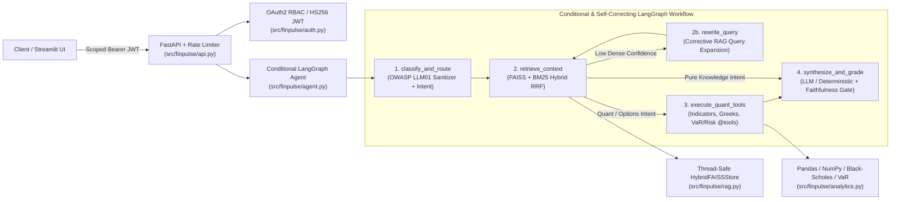
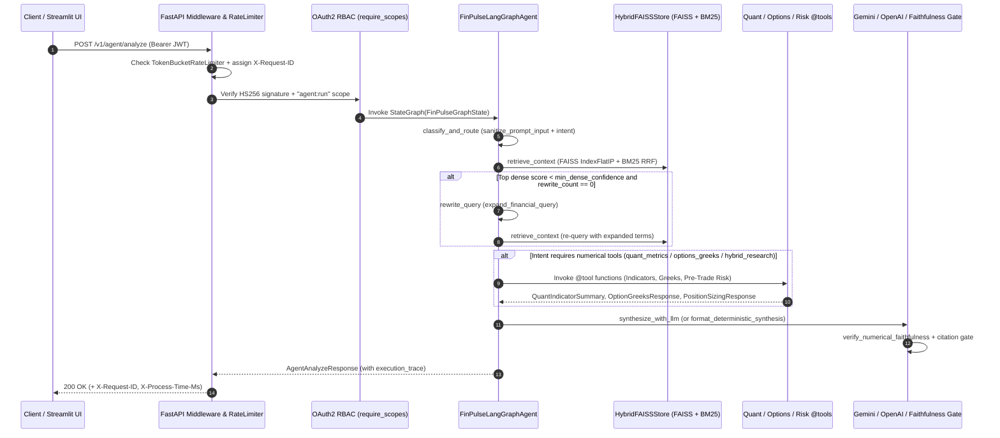

# System Architecture — FinPulse AI Agent

## 1. Overview & Design Goals

`FinPulse AI Agent` (`v0.2.0`) is a containerized Python microservice and interactive evaluation suite designed for **grounded financial research and quantitative derivatives/intraday analysis**. It solves three core failure modes of naive LLM financial wrappers:

1. **Unverified numerical hallucination:** Free-form LLMs routinely miscalculate VWAP bands, ATR stop distances, or Black-Scholes option Greeks. In `FinPulse AI`, all numerical metrics are computed deterministically by vectorized **Pandas / NumPy** and analytical **Black-Scholes-Merton** `@tool` functions (`src/finpulse/analytics.py`) and cross-checked post-synthesis via `verify_numerical_faithfulness` (`src/finpulse/agent.py`).
2. **Pure-vector retrieval misses exact financial symbols & formulas:** Dense embeddings alone often miss exact ticker filters (`NIFTY`, `BANKNIFTY`), strike numbers, or domain acronyms (`RVOL`, `VWAP`, `OWASP LLM01`). `FinPulse AI` fuses **Hugging Face (`BAAI/bge-small-en-v1.5`) + FAISS (`IndexFlatIP`)** cosine similarity with **Okapi BM25** lexical scoring via **Reciprocal Rank Fusion (RRF)**.
3. **Unnecessary tool latency on pure knowledge queries:** Instead of a rigid linear chain, the `LangGraph` workflow uses conditional edges (`add_conditional_edges`) to trigger Corrective RAG query expansion on low-confidence retrievals and to bypass quantitative tool execution on pure knowledge queries.

---

## 2. High-Level Architecture & Request Flow

### End-to-End Sequence Diagram (`POST /v1/agent/analyze` & `/v1/agent/stream`)

---

## 3. Conditional `LangGraph` Workflow (`src/finpulse/agent.py`)

The agent state (`FinPulseGraphState`) is a strictly typed `TypedDict` carrying the request, sanitized query, active search query, rewrite counter, routed intent, retrieved citations, quantitative/options/risk outputs, synthesized report, hallucination & numerical faithfulness gate statuses, confidence score, and per-node execution trace.

| Node | Responsibility | Inputs Read | State Keys Written |
| --- | --- | --- | --- |
| **`1. classify_and_route`** | Strips prompt-injection payloads (`sanitize_prompt_input`) and classifies the query into one of four execution intents: `quant_metrics`, `options_greeks`, `rag_knowledge`, or `hybrid_research`. | `request` | `sanitized_query`, `active_search_query`, `rewrite_count`, `routed_intent`, `execution_trace` |
| **`2. retrieve_context`** | Queries `HybridFAISSStore.search()` using Reciprocal Rank Fusion ($k=60$) over FAISS cosine similarity and BM25 lexical scores. | `active_search_query`, `request.top_k` | `citations`, `execution_trace` |
| **`2b. rewrite_query`** | Triggered via `add_conditional_edges` when initial retrieval similarity falls below `min_dense_confidence` (`rewrite_count < 1`). Expands financial acronyms/synonyms and loops back to `retrieve_context`. | `sanitized_query`, `rewrite_count` | `active_search_query`, `rewrite_count`, `execution_trace` |
| **`3. execute_quant_tools`** | Conditionally routed for `quant_metrics`, `options_greeks`, and `hybrid_research` intents (bypassed via conditional edge on pure `rag_knowledge` queries). Invokes `compute_intraday_indicators_tool`, `compute_option_greeks_tool`, and `compute_position_risk_tool`. | `routed_intent`, `request.bars`, `request.option_params`, `request.risk_params` | `quant_summary`, `option_greeks`, `risk_summary`, `execution_trace` |
| **`4. synthesize_and_grade`** | Calls `synthesize_with_llm` (Gemini / OpenAI REST API when configured, falling back to `format_deterministic_synthesis`), runs `verify_numerical_faithfulness` and the citation gate (`hallucination_check_passed`), and computes a bounded confidence score (`0.55..0.99`). | `citations`, `quant_summary`, `option_greeks`, `risk_summary` | `answer`, `hallucination_check_passed`, `numerical_faithfulness_passed`, `confidence_score`, `execution_trace` |

---

## 4. Hybrid RAG Pipeline & Concurrency Architecture (`src/finpulse/rag.py`)

### 4.1 Recursive Markdown Chunking & SHA-256 Deduplication (`chunk_document`, `ingest_documents`)

- Splits documents along Markdown level-1/level-2 headers (`#` / `##`) first so conceptual sections stay intact.
- If a section exceeds `chunk_size` (default `420` characters), slices it with a sliding window (`chunk_overlap = 60` characters) while preserving `doc_id`, `title`, `category`, and optional `ticker` metadata on every chunk (`<doc_id>#c<seq>`).
- Each candidate chunk is hashed via SHA-256 (`"{doc_id}::{chunk_id}::{text}"`) and checked against `_seen_hashes` inside a `threading.RLock` critical section so repeated `POST /v1/rag/ingest` calls are strictly idempotent.

### 4.2 Hugging Face Dense Embeddings & `FAISS` Indexing (`encode_texts_dense`)

- Uses **Hugging Face `SentenceTransformer("BAAI/bge-small-en-v1.5")`** (with `local_files_only=True` cache-first loading, thread-safe `_VECTOR_CACHE`, and deterministic `encode_texts_hash` fallback for offline/air-gapped CI) to produce 384-dimensional `float32` vectors normalized to unit $L_2$ length ($\|\mathbf{v}\|_2 = 1$).
- Because vectors are $L_2$-normalized, exact inner-product search in **`faiss.IndexFlatIP(384)`** is mathematically identical to cosine similarity:
  $$\cos(\mathbf{q}, \mathbf{d}) = \frac{\mathbf{q} \cdot \mathbf{d}}{\|\mathbf{q}\|_2 \|\mathbf{d}\|_2} = \mathbf{q} \cdot \mathbf{d}$$

### 4.3 BM25 + Reciprocal Rank Fusion (`HybridFAISSStore.search`)

- Every candidate chunk passing metadata filters (`category`, `ticker`) is ranked independently by:
  1. **Dense rank** $r_{\text{dense}}(i)$ from `faiss.IndexFlatIP` cosine similarity.
  2. **Lexical rank** $r_{\text{bm25}}(i)$ from Okapi BM25 ($k_1 = 1.5, b = 0.75$).
- Ranks are fused via **Reciprocal Rank Fusion (RRF)** with constant $k = 60$:
  $$\text{RRF}(i) = \frac{1}{60 + r_{\text{dense}}(i)} + \frac{1}{60 + r_{\text{bm25}}(i)}$$

---

## 5. Security, Rate Limiting & Observability (`src/finpulse/auth.py`, `src/finpulse/api.py`)

1. **OWASP LLM01 Prompt-Injection Sanitizer (`sanitize_prompt_input`):**
   - Iteratively strips XML/HTML role delimiters (`<system>`, `<instructions>`, `<prompt>`, `<developer>`, `<tool_call>`), instruction-override phrases (`Ignore all previous instructions`, `You are now in developer mode`), and ASCII control characters before embedding or agent routing.
2. **OAuth2 Scope-Based RBAC (`require_scopes`):**
   - Token issuance at `POST /v1/auth/token` validates client credentials in constant time using `hmac.compare_digest` and signs short-lived `HS256` JWTs (`iss = "finpulse-ai-agent"`).
   - Write and agent-execution endpoints (`POST /v1/rag/ingest` -> `rag:write`; `POST /v1/agent/analyze` and `POST /v1/agent/stream` -> `agent:run`) enforce fine-grained scopes via `Depends(require_scopes(...))`, returning `401 Unauthorized` for missing/invalid tokens and `403 Forbidden` for insufficient scope grants.
3. **Token-Bucket Rate Limiting & Telemetry (`TokenBucketRateLimiter`, `ServiceTelemetry`):**
   - `observability_and_rate_limit_middleware` enforces a per-client token bucket (`25 req/sec` refill, `50` burst capacity), attaches `X-Request-ID` and `X-Process-Time-Ms` headers to every response, and records rolling latency percentiles (`p50`, `p95`, `mean`) exposed at `GET /metrics`.
4. **Broker OAuth2 `appIdHash` Helper (`compute_oauth2_app_id_hash`):**
   - Generates the SHA-256 hex digest of `"{app_id}:{secret_key}"` required by broker OAuth2 authorization-code token exchanges.

---

## 6. Environment Variable Reference

| Variable | Default | Description |
| --- | --- | --- |
| `FINPULSE_HF_MODEL` | `BAAI/bge-small-en-v1.5` | Hugging Face `SentenceTransformer` model identifier (`384`-dim) |
| `FINPULSE_EMBEDDING_BACKEND` | `auto` | Set to `hash` to force deterministic feature-hash embeddings without PyTorch |
| `FINPULSE_ALLOW_HF_DOWNLOAD` | `0` | Set to `1` in CI/Docker to allow downloading weights if not in local cache |
| `GEMINI_API_KEY` | *(unset)* | Optional Google Gemini API key for live LLM synthesis in `_synthesize_and_grade` |
| `FINPULSE_GEMINI_MODEL` | `gemini-2.0-flash` | Gemini model used when `GEMINI_API_KEY` is configured |
| `OPENAI_API_KEY` | *(unset)* | Optional OpenAI-compatible API key for live LLM synthesis |
| `OPENAI_BASE_URL` | `https://api.openai.com/v1` | Base URL for OpenAI-compatible chat completions endpoint |
| `FINPULSE_OPENAI_MODEL` | `gpt-4o-mini` | OpenAI model used when `OPENAI_API_KEY` is configured |
| `FINPULSE_JWT_SECRET` | `finpulse-dev-hmac-...` | HMAC-SHA256 secret key used to sign and verify OAuth2 Bearer JWTs |
| `FINPULSE_CLIENT_ID` | `finpulse-client` | Default OAuth2 client identifier for `POST /v1/auth/token` |
| `FINPULSE_CLIENT_SECRET` | `finpulse-secret-2026` | Default OAuth2 client secret for `POST /v1/auth/token` |
